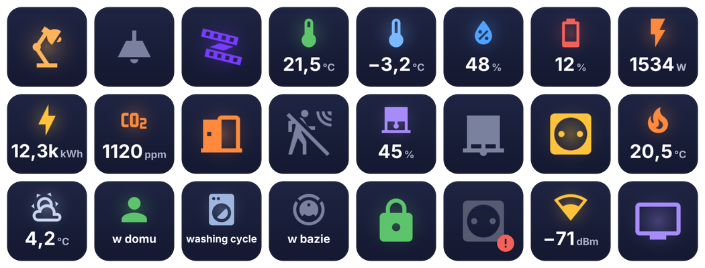

# Home Assistant (encje) – wtyczka do Ulanzi Studio

Dowolna encja z dowolnego serwera Home Assistant na przycisku Ulanzi Deck.
Przycisk przełącza światło, gniazdko czy roletę i pokazuje ikonę, która sama dopasowuje się do encji
i jej stanu. Czujniki mają wartość narysowaną na ikonie, na przykład temperaturę albo wilgotność.



## Co potrafi

- **Dowolny serwer HA:** adres lokalny (`http://192.168.1.10:8123`) albo zdalny (`https://moj-ha.pl`) i token długoterminowy.
  Stan odświeża się na żywo przez WebSocket, więc przycisk zmienia się od razu, także gdy przełączysz coś w aplikacji HA.
- **Wygodny wybór encji:** po kliknięciu **Połącz** wpisz kilka słów, na przykład „lampa biurko”, a lista pokaże pasujące encje
  z identyfikatorem i nazwą.
- **Automatyczne ikony** dla każdej encji, z tego samego zestawu co Home Assistant (Material Design Icons):
  - ikona zależy od domeny, `device_class`, stanu i nazwy encji (gniazdko, roleta, bezpiecznik, pralka, projektor,
    ustawienia kamer, drukarek, robotów i wiele innych), a ikona ustawiona w HA (`icon: mdi:…`) ma pierwszeństwo;
  - **czujniki pokazują wartość:** temperatura (kolor termometru zależy od temperatury), wilgotność, bateria
    (z poziomem naładowania), moc, energia, CO₂, pył, sygnał Wi‑Fi, tonery w drukarce i inne. Duże liczby są skracane (12,3k);
  - **światła i przełączniki świecą,** gdy są włączone. Lampa RGB świeci swoim aktualnym kolorem;
  - **tekst zamiast liczby,** gdzie ma to sens: osoba („w domu”), robot („w bazie”), listy wyboru, godziny;
  - **encja niedostępna** jest wyszarzona i ma czerwony wykrzyknik.
- **Własne obrazy** dla stanów włączona / wyłączona / niedostępna: PNG, JPG albo **animowany GIF**. Mają pierwszeństwo przed ikoną automatyczną.
- **Co robi naciśnięcie:** przełącz, włącz, wyłącz, nic albo dowolna usługa HA z danymi JSON.
  Sceny i skrypty się uruchamiają, przyciski są naciskane, zamki zamykane i otwierane.
  Czujniki i inne encje tylko do odczytu po naciśnięciu nic nie robią.
- **Napis na przycisku:** stan, nazwa encji albo własny tekst z polami `{state}`, `{unit}`, `{name}`, `{attr.nazwa}`.

## Instalacja

1. Pobierz `com.ulanzi.halamp.ulanziPlugin.zip` z zakładki **[Releases](../../releases/latest)**.
   Możesz też pobrać całe repozytorium przyciskiem **Code → Download ZIP**.
2. Naciśnij **Win+R**, wpisz `%APPDATA%\Ulanzi\UlanziDeck\Plugins` i naciśnij Enter.
3. Wypakuj tam archiwum. W środku ma być od razu folder `com.ulanzi.halamp.ulanziPlugin`, a nie folder w folderze.
4. Zamknij Ulanzi Studio (prawy przycisk na ikonie przy zegarze Windows → wyjście) i uruchom je ponownie.
5. Na liście akcji znajdziesz kategorię **Home Assistant (encje) → Encja HA**. Przeciągnij ją na przycisk.
6. Kliknij przycisk w Ulanzi Studio, wpisz adres serwera i token, kliknij **Połącz** i wybierz encję.

Token utworzysz w Home Assistant: **Twój profil → Bezpieczeństwo → Tokeny długoterminowe**.
Kolejne przyciski dostaną adres i token automatycznie, wystarczy wybrać encję.

Wtyczka jest gotowa do użycia: biblioteka `ws` jest dołączona, nie trzeba nic doinstalowywać.

## Ustawienia przycisku

| Ustawienie | Co robi |
|---|---|
| **Ikona** | *Automatyczna z wartością* (domyślnie), *Automatyczna bez wartości* albo *Klasyczna* (proste obrazy z wersji 2.0). |
| **Własne obrazy** | Plik PNG, JPG lub GIF dla stanu włączona / wyłączona / niedostępna. Puste pole oznacza ikonę automatyczną. |
| **Po naciśnięciu** | Przełącz, włącz, wyłącz, własna usługa (np. `light.turn_on` z `{"brightness_pct": 50}`) albo nic. |
| **Napis na przycisku** | Nic, stan, nazwa encji albo własny tekst. |

## Aktualizacja

Zamknij Ulanzi Studio, wypakuj nową wersję w to samo miejsce z nadpisaniem plików i uruchom Studio ponownie.
Ustawienia przycisków, adres serwera i token zostają.

## Wymagania

- Windows 10 lub 11
- Ulanzi Studio 2.1 lub nowsze
- Home Assistant z tokenem długoterminowym

## Prywatność

Adres serwera i token są zapisywane tylko na Twoim komputerze: w ustawieniach przycisków Ulanzi Studio
i w pliku `config.json` w folderze wtyczki. Wtyczka łączy się wyłącznie z Twoim serwerem Home Assistant.

## Rozwiązywanie problemów

Wtyczka zapisuje dziennik w pliku `plugin.log` w swoim folderze, na przykład:

```
HA https://moj-ha.pl połączono (HA 2026.11.3)
run light.lampa_biurko -> homeassistant.toggle ok
```

- **„nieprawidłowy token”:** utwórz nowy token długoterminowy w profilu HA i wklej go ponownie.
- **Przycisk pokazuje czerwony wykrzyknik:** encja jest niedostępna w HA albo wtyczka nie może połączyć się z serwerem. Sprawdź `plugin.log`.
- **Ikona nie pasuje do encji:** ustaw w HA ikonę encji (`mdi:…`), a wtyczka jej użyje, albo wybierz własne obrazy.
  Możesz też zgłosić to w [Issues](../../issues). Po otwarciu ustawień przycisku wtyczka zapisuje w swoim folderze plik
  `icons_report.tsv`, który pokazuje, jaką ikonę dostała każda encja.

## Struktura

```
com.ulanzi.halamp.ulanziPlugin/
├── manifest.json            opis wtyczki dla Ulanzi Studio
├── plugin/
│   ├── app.js               połączenie ze Studio, obsługa przycisków i naciśnięć
│   ├── ha.js                klient WebSocket API Home Assistanta
│   ├── icons.js             dobór ikon do encji i rysowanie przycisku
│   └── png.js               renderer i zapis PNG (bez zewnętrznych bibliotek)
├── property-inspector/      panel ustawień przycisku w Ulanzi Studio
├── libs/                    biblioteki Ulanzi do panelu ustawień
├── images/
│   ├── icons.pack           ikony Material Design Icons i litery do napisów
│   └── *.png                obrazy wbudowane
└── node_modules/ws          biblioteka WebSocket
tools/build_icons_pack.py    skrypt, który buduje images/icons.pack
```

## O wtyczce i licencja

Wtyczka jest **darmowa**. Napisałam ją we współpracy z [Claude](https://claude.ai), asystentem AI firmy Anthropic.

Możesz ją bezpłatnie pobierać, instalować i używać, także w pracy. Obowiązują dwa zastrzeżenia:

- **nie wolno jej modyfikować** ani rozpowszechniać zmienionych wersji bez mojej zgody (o zgodę poproś, zakładając [Issue](../../issues)),
- **nie wolno na niej zarabiać**: sprzedawać jej, pobierać opłat za jej udostępnienie ani dołączać do płatnych produktów.

Pełne warunki są w pliku [LICENSE](LICENSE).

Elementy zewnętrzne mają własne licencje: biblioteka `ws` (MIT), ikony
[Material Design Icons](https://pictogrammers.com/library/mdi/) (Pictogrammers Free License, Apache 2.0)
i czcionka [Inter](https://rsms.me/inter/) (SIL Open Font License 1.1).
Home Assistant jest znakiem jego twórców. Ta wtyczka nie jest oficjalnym produktem Home Assistant ani Ulanzi.
